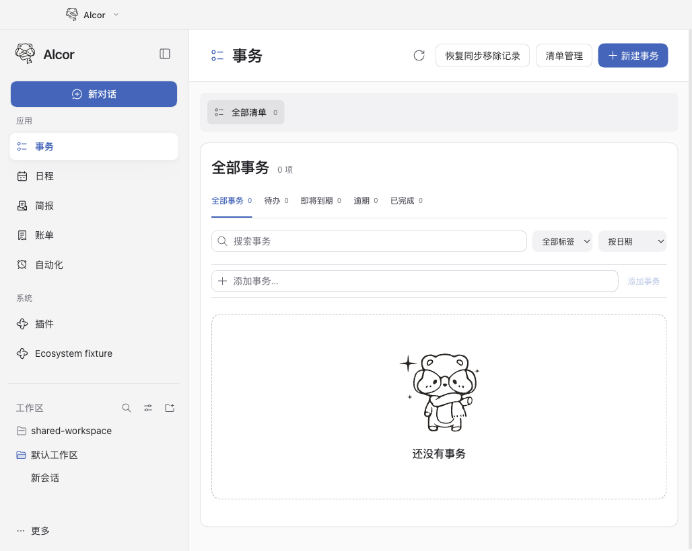
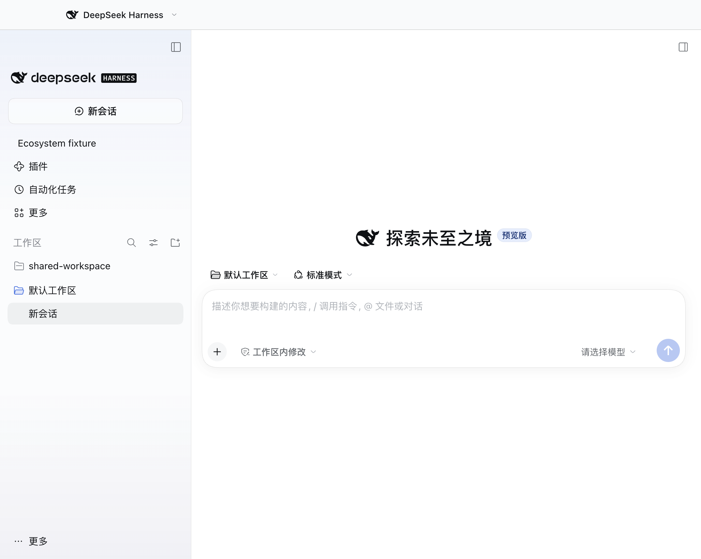

<p align="center"></p>

# Alcor

[English](README.md) · [中文](product/README.md) · [繁體中文（舊版）](docs/zh/README-Hant.md) · [日本語（旧版）](docs/ja/README.md)

Alcor is a personal assistant plugin for the official DeepSeek Harness (DSH) desktop app. It adds tasks, a calendar, bills, briefings and automation, with its own bear branding and sidebar. Use the top-left menu to switch between Alcor and the native DSH interface in the same window.

Both views share the same running host, profile, models, conversations, workspaces, configuration and plugin directory. Alcor installs through the standard plugin manager and leaves the official app, signature and updater intact. DSH can update independently; compatibility is checked for each supported release.

## A look inside

Alcor keeps its application and system groups; switching back restores the official DSH sidebar. The workspace named `shared-workspace` below is the same workspace in both views.

| Alcor | Official DSH |
| --- | --- |
|  |  |

These are real renderer captures from official DSH 0.2.2-rc.2 with Alcor 0.1.104 in a disposable test profile. All visible records are synthetic. See the [product guide](product/README.md#自动化) for the automation view.

## Desktop installation

Alcor 0.1.104 has been exercised on official DSH 0.2.2-rc.1 and rc.2 on macOS Apple Silicon and Windows x64. Optional bundles have their own platform and host-version requirements; see the [tested scope](product/README.md#平台与验证范围) and [official release identities](product/desktop-release.lock.json).

1. Open the plugin manager in an initialized DSH profile and install the `@alcor/secretary` bundle from its `.tgz` file.
2. Install any optional plugins you need from the table below.
3. Quit and reopen DSH, then select **Alcor** in the top-left mode menu. Switching views is immediate and keeps the same background host.

Use the plugin manager to enable, disable or uninstall Alcor, then reopen DSH. Existing Stella or separate Alcor environments need a backed-up, verified migration before reuse; installing a bundle does not automatically transfer their data. See the [installation and data guide](product/README.md#安装与数据).

| Plugin | What it adds |
| --- | --- |
| `@alcor/secretary` | Manage tasks and subtasks, view events, record bills, generate briefings and schedule updates. |
| `@alcor/apple-sync` | Sync events and tasks with Apple Calendar and Reminders after selecting and authorizing sources. |
| `@alcor/elearning` | Connect a Fudan eLearning account to read courses, assignments and announcements. |
| `@alcor/mail` | Connect IMAP mailboxes for read-only queries and briefing sources. |
| `@alcor/agent-hub` | Track development tasks and agent execution in the DSH workbench. |

Apple sync, school and mail bundles currently target macOS. AgentHub 0.1.4 declares alpha.3/rc.1 support, not rc.2. QQ and the desktop pet are separate AuraBot plugins; see the [channel guide](product/channels.md) and [bear artwork](assets/desktop-pet/README.md).

## Local development

Use Node.js 24.9 or later and Python 3.9 or later. Building the macOS helpers also requires the Xcode Command Line Tools. On macOS, run these commands from the repository root; Windows setup is in the [development guide](product/README.md#开发与打包).

```sh
npm ci --ignore-scripts
npm run product:build
npm test
npm run dev
```

The web preview uses a separate development profile and does not replace official desktop acceptance. To build the secretary plugin, run `npm run product:pack`; its `.tgz` is written to `.local/artifacts/`. Windows development setup and desktop checks are documented in the [product guide](product/README.md#开发与打包). School and mail bundles require the adjacent MCP repositories and pinned build dependencies; see the [connector guide](product/mcp-connections.md).

Native plugin sources live under `packages/`, build scripts under `scripts/product/`, and integration tests under `product/tests/`. The earlier standalone Python/Electron application is documented in the [legacy guide](docs/guide.md).

Run `make audit` for the complete current plugin build and test suite. Native CI also checks portable Windows/Linux services, frozen school/mail connector protocols and the macOS credential provider in a temporary Keychain. Changes to the retained Python/Electron runtime still trigger its own maintenance checks; its complete audit is `make audit-legacy`. See the [CI coverage map](docs/development/ci-coverage.md) for exact triggers, preserved isolation/migration/security tests, verified results and desktop acceptance limits.

## Source and license

Alcor is independently developed from [CowAgent](https://github.com/zhayujie/CowAgent) (formerly `chatgpt-on-wechat`) by zhayujie and contributors. It reuses the upstream Agent, model, tool, skill, memory, and messaging foundations, and adds desktop workflows plus shared business services for tasks, calendars, bills, briefings, and security management.

See [third-party notices](THIRD_PARTY_NOTICES.md) for source attribution and the [MIT license](LICENSE) for license terms.

## A note from the author

This is the first open-source project I completed on my own. Thanks to Codex and Cursor for help during development. There is still work to do; suggestions and bug reports through [Issues](https://github.com/starpickerr/Alcor/issues) are welcome.
