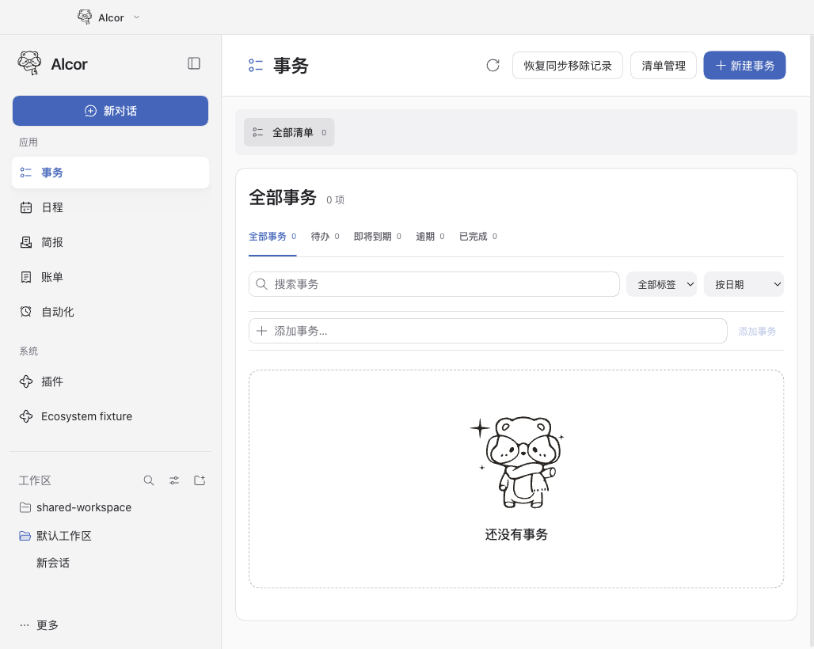
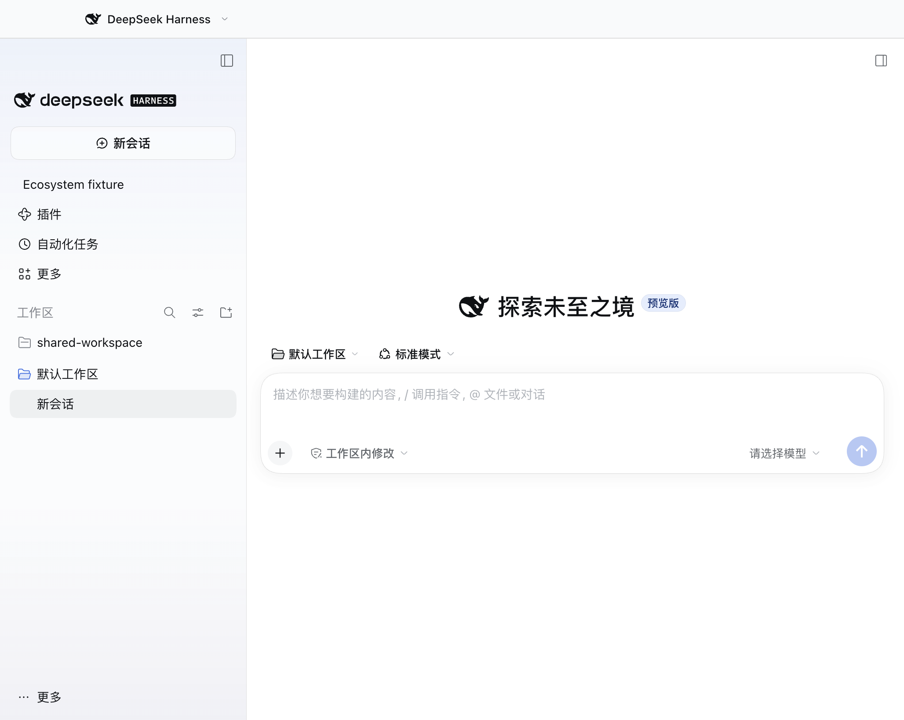
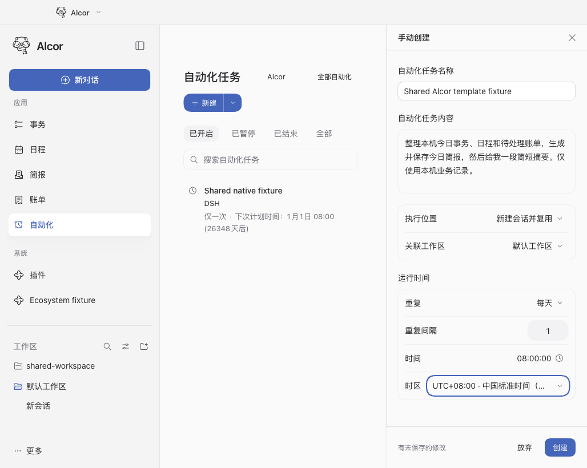

# 在官方 DSH 中使用 Alcor

Alcor 是安装在原版官方 DeepSeek Harness（DSH）桌面客户端中的可选插件，当前秘书包为 `@alcor/secretary@0.1.106`。左上角菜单在同一窗口切换 **Alcor** 与 **DeepSeek Harness**。Alcor 保留小熊品牌、原侧栏、应用／系统分组和业务页面；切回 DSH 恢复官方原生侧栏。

两个界面共用同一个 Host、Profile、运行环境、模型、配置、会话、工作区和插件目录。切换只改变界面，不启动第二个 Host，后台继续运行。第三方插件原样安装，Alcor 的「系统」分组仍打开它们自己的页面。

Alcor 使用官方插件接口和公开 UI 插槽，不修改或覆盖官方程序、UI 模块、签名和更新器，也不固定用户的 DSH 版本。官方客户端可以独立更新；插件需按宿主版本适配和验证。已通过的版本不代表未来版本无需适配。

## 安装与数据

1. 安装官方 DSH，完成目标 Profile 的初始化。已验证的桌面版本和产物身份见[版本清单](desktop-release.lock.json)，各插件仍须满足自身 `engines.dsh` 和平台声明。
2. 在 DSH 的「插件」页选择「添加插件」，安装 `alcor-secretary-0.1.106.tgz`。构建方法见[开发与打包](#开发与打包)。安装不需要单独的 Alcor 客户端或修改官方文件。
3. 退出并重新打开 DSH，在左上角菜单选择 Alcor。日常模式切换即时生效；安装、启用、停用及卸载后按重启使用。
4. 按需安装下表中的独立插件，账号与插件设置由 DSH 原生插件页管理。

| 安装标识 | 用途与范围 |
| --- | --- |
| `@alcor/secretary` | Alcor 事务、日程、简报、账单、自动化与专用对话；本轮已验 macOS Apple Silicon 和 Windows x64。 |
| `@alcor/apple-sync` | Apple Calendar／Reminders 同步；当前安装包仅 macOS，权限与限制见[Apple 插件说明](../packages/alcor-apple-sync/README.md)。 |
| `@alcor/elearning` | 复旦 eLearning 课程、作业与公告；当前安装包仅 macOS，见[MCP 接入](mcp-connections.md)。 |
| `@alcor/mail` | IMAP 邮件只读查询与简报来源；当前安装包仅 macOS，见[MCP 接入](mcp-connections.md)。 |
| `@alcor/agent-hub` | 独立开发者协作插件；0.1.5 支持 alpha.3／rc.1／rc.3，rc.2 尚未验证。 |

QQ 与桌宠来自独立 AuraBot 社区插件。秘书不加载社交人格、长期社交记忆或主动交流队列；小熊形象包与安装边界见[桌宠说明](../assets/desktop-pet/README.md)，通道设置见[QQ 社交与秘书业务](channels.md)。

秘书业务库位于目标 Profile 的 `alcor/business/`。停用或卸载不应作为清空数据的方法；重新安装验收核对原工作区和事务 ID 保留。桌面使用官方 DSH 提供的 Python 解释器，普通用户无需为秘书另装 Python。

已有 Stella Profile 或独立 Alcor 环境不会在安装时自动迁入。迁移需停写、备份、核对业务库及外部来源映射，保留原始环境和恢复材料；不覆盖原生会话、无关配置和凭据，不同时启用两套同步或机器人写入源。离线接续工作区还须保持记录、`global.workspaceIds` 顺序及每个会话唯一归属一致。个人数据盘点、迁移回执和截图留在本机，不进入仓库。[工作区迁移说明](workspace-migration.md)提供相关背景。

## 界面与共享关系

| Alcor 事务页 | 官方 DSH |
| --- | --- |
|  |  |

左上角按钮通过官方 `shell.overlay` 插槽呈现，保留 44px 标题栏位置。侧栏借助可逆的 Loader 生命周期交接，工作区与设置仍由官方组件提供。两种界面使用同一工作区目录和插件管理器，无须按模式重复安装插件。

共享模式不是数据或进程隔离。原生插件属于同进程可信代码，模式切换不构成操作系统沙箱。工具执行继续遵循 DSH 当前会话的权限、审批和凭据设施；打开页面或切换界面本身不调用模型。

## 自动化

Alcor 保留自己的自动化管理页，提供每日简报模板、手动创建和「全部／Alcor」查看范围，默认显示全部原生任务。范围切换只筛选显示。新建的 Alcor 任务带有 Alcor owner／preset；DSH 仍使用未覆盖的官方自动化页面。两个入口共享任务 ID、运行历史和唯一的 DSH 调度器。



模板保存前不调用模型。执行时，任务所选的业务或外部来源内容可能发送给用户配置的模型；DSH 需运行才能调度。Alcor 自有 UI 与官方页面的样式和注册分开，不替换官方 `schedules` 页面。

Alcor 保留删除保护：公开接口无法证明待投递状态时拒绝删除，不以确认框代替安全删除契约，也不绕过保护直接调用原生删除。

## 业务入口

- **事务与日程**：管理清单、子事务、重复任务、分类和日期视图。事务与日程页面中的任务引用同一记录，详情与编辑使用右侧面板；来源只读状态及 Apple 权限继续生效。
- **简报**：在「简报 → 设置」选择来源和规则。插件／账号可用性与简报来源开关分别控制，两层有效才采集；失败不推进来源游标。运行、来源和规则按任务记录保存，重启后可显式继续。来源契约见[简报插件适配](briefing-plugin-adapters.md)。
- **账单**：查看流水、月／年报表、分类及币种汇总。对话可按要求导入微信 XLSX／支付宝 CSV，文件须在 DSH 授权范围内；按交易号去重，不覆盖同号冲突流水。每次最多 5 个文件，单个 5 MB、合计 20 MB、每文件 10000 笔。导入工具只返回计数与汇总，不将原文件正文回传模型。
- **对话与自动化**：页面与对话共用领域服务，已授权的操作无需再次到页面确认；宿主必要的权限和破坏性操作确认仍生效。工具范围与文件限制见[页面业务工具](page-tools.md)。

Apple 真实账号、邮件／学校真实服务与合成测试分别留证，不因页面加载成功就宣称外部集成完成。可选 Keychain 包默认停用，其验证边界见[凭据插件说明](../packages/alcor-privacy/README.md)。

## 开发与打包

开发需要 Node.js >=24.9 和 Python >=3.9。macOS 构建 Apple 原生桥还需要 Xcode Command Line Tools。在产品仓库根目录运行：

```sh
npm ci --ignore-scripts
npm run product:pack
npm test
```

秘书归档写入 `.local/artifacts/`，当前为 `alcor-secretary-0.1.106.tgz`。记录提交、包版本和归档／客户端摘要，不仅凭版本号判断产物身份。Windows 开发依赖树包含仅 macOS 的工作区包，按现有 CI 使用 `npm ci --force --ignore-scripts`；该选项只用于开发检出，不用于官方 Profile 安装或跳过兼容检查。

| 命令 | 产物或用途 |
| --- | --- |
| `npm run product:pack` | 秘书插件。 |
| `npm run product:hub:pack` | 独立 AgentHub 插件。 |
| `npm run product:apple:pack` | macOS Apple 同步插件及原生桥。 |
| `npm run product:sources:pack` | macOS 学校／邮件插件及冻结 MCP；依赖相邻 MCP 仓库，见[MCP 接入](mcp-connections.md)。 |
| `npm run dev` | 使用专用开发 Profile 的 Web 预览；不替代官方桌面验收。 |

源码在 `packages/`，构建脚本在 `scripts/product/`，产品测试在 `product/tests/`。模式读取代码会编入各插件客户端；修改该契约时应重建所有受影响包，并分别遵守平台和宿主版本范围。旧 Python/Electron 路径的 `make test-legacy` 不作为当前原生插件交付证据。

## 平台与验证范围

以下记录针对 2026-11-12 的秘书 0.1.104。运行检查与真实个人安装分别记录；绿色 CI 不替代桌面交互验收。

| 环境 | 已验证范围 |
| --- | --- |
| 官方 Mac rc.2，临时 Profile、合成数据 | 同窗切换、共享工作区／插件目录、原侧栏、设置、自动化模板与手动创建、范围筛选、Alcor preset 与原生同一任务 ID、热停用／重启用、窄窗抽屉、弹窗阻断、重启和冷停用恢复。1280×540 视口的时区菜单边界、Escape 关闭及焦点返回通过。 |
| 官方 Mac rc.1，个人安装 | 已安装 0.1.104，安装前后 13 个数据文件摘要一致；双向切换、原任务、空创建表单及菜单只读观察通过。个人截图不公开。 |
| 官方 Windows x64 rc.1 → rc.2，临时 Profile | 升级保留任务、工作区和配置；共享自动化模板／手动创建／范围及同一任务 ID、540px 高时区菜单与 Escape、720px 窄窗及原生 Ctrl+B 通过。标题栏真实拖动在 DSH 模式 720px 宽窗口通过；rc.2 Alcor 模式在外宽 720px／1180px（内宽 704px／1164px）均完成真实位移且尺寸不变。右侧两栏外边界 576→700、内部 350/350→422/278 的物理拖动通过，正文仍可见。 |
| 官方 Windows x64 rc.2，个人安装 | 已安装 0.1.104；配置与数据保留，工作区文件字节一致，会话 ID 保留。 |
| 产品自动化检查 | 本地完整产品测试 534 通过、1 个平台跳过、0 失败；Windows 专项 45 通过。测试服务和合成账号不代表真实外部账号验收。 |

**尚未验证**：Mac 真实标题栏拖动与右侧分栏实际拖动，以及本轮 AgentHub 实际开发会话创建。Windows 的最小化／最大化／关闭按钮仅做命中测试，未逐项点击；DSH 模式 1180px 宽窗口的真实拖动未验。当前结果不构成所有插件、所有交互或未来 DSH 版本的兼容保证。

复现入口为 `product/tests/official-shared-check.py`（Mac）与 `product/tests/official_shared_windows.py`（Windows）；后者的安装和环境参数见[Windows 验证说明](windows-native.md)。测试必须使用可丢弃的独立 HOME／DSH_HOME、合成数据和已核验的官方程序，不连接个人账号。最终产物同时核对官方签名、归档身份及运行结果。

本页及根 README 的三张截图来自官方 Mac rc.2、秘书 0.1.104 的合成 Profile 验收，已逐张查看，未包含个人数据或凭据。`alcor-shared-tasks.png`、`dsh-shared-workspace.png`、`alcor-automation-template.png` 分别为验收原图 `shared.png`、`dsh-top.png`、`alcor-automation-template.png` 的原样副本；不代表 Windows 原生窗口外观。

## DSH 更新与兼容边界

秘书 0.1.106 将业务工具和按需加载的技能注册到插件层，普通 DSH、Alcor 及历史 Stella 主会话均可调用；当前用户来源、宿主拒绝、子会话限制和具体操作审批继续生效。安装插件不把 Alcor 的文件／MCP 策略施加给普通 DSH 预设。事务数据以当前业务工具为准，不直接查询旧归档或 SQLite。此入口已在官方 Mac rc.3 使用隔离数据和模拟模型验证三种预设的实际工具目录、技能读取和事务查询；Windows 0.1.106 的实际对话入口待补验，不能复用下述 0.1.105 的桌面结果宣称通过。入口为 `product/tests/shared-business-tools.test.mjs` 和 `product/tests/shared-business-chat-check.py`。

2026-11-14 补验官方 Mac Apple Silicon rc.3：产品测试 538 通过、1 个平台跳过；同窗切换、自动化、窄窗与弹窗、重启和停用恢复通过。五个插件在 rc.1 上安装旧包后升级到 rc.3，再更新插件并重启，原事务、工作区、启用列表和 owner 文件保留；不兼容旧插件被跳过时，原生 DSH 仍可使用。学校／邮件的冻结协议、配置 UI、原生凭据、来源发现、停用／恢复／卸载检查及秘书卸载重装数据保留通过。以上使用隔离 Profile、合成数据；未运行真实 Apple／学校／邮件账号操作。

同日补验官方 Windows x64 rc.2 → rc.3：秘书 0.1.105、AgentHub 0.1.5 启用与停用恢复，旧事务／自动化任务 ID、工作区和会话关联保留；同窗双向切换、共享插件目录与工作区、自动化模板／手动创建／筛选及原生同一任务、540px 高菜单与 Escape 焦点、宽窄标题栏和右侧两条分隔线的实际拖动通过，Windows 专项 39 项通过。个人官方客户端原地升级后，两插件、原工作区／会话及配置已核对；Mac 专用包不计入 Windows 功能验收。复现与源码测试平台边界见[Windows 验证说明](windows-native.md)。

秘书 0.1.105 的宿主范围为 `0.2.2-alpha.3 || 0.2.2-rc.1 || 0.2.2-rc.2 || 0.2.2-rc.3`。Apple 0.1.20、eLearning 0.1.14、邮件 0.1.13、AgentHub 0.1.5 分别增加精确 rc.3 支持；其他历史范围保持不变。rc.3 本轮验证对象为官方 macOS Apple Silicon 和 Windows x64，具体插件与操作以上述各平台记录为准，不能据此宣称所有历史版本均完成相同验收。

插件使用运行中宿主提供的可选 peer SDK，不把旧 `@deepseek-ai/*` 核心组件安装进 Profile。宿主升级时，须检查配置、业务数据、插件生命周期，以及插件不兼容时官方 DSH 是否仍能启动。不要通过放宽 `engines.dsh`、关闭兼容检查、修改或固定官方程序来维持旧插件运行。

`product/tests/upgrade-compatibility-check.py` 使用五个旧包复现宿主升级后的不兼容状态，再安装当前五个包，核对插件服务、重启、工作区和事务唯一 ID、启用列表及 owner 文件保留。先构建秘书、Apple、学校／邮件和 AgentHub 包，再设置 `ALCOR_PREVIOUS_DESKTOP_APP`（已验证的旧官方程序）、`ALCOR_PREVIOUS_ARTIFACTS`（不支持新宿主的五个旧包目录）、`STELLA_CHECK_DESKTOP_APP`（新官方程序）和 `STELLA_CHECK_ARTIFACTS`（验证输出目录）执行该脚本；两个程序都必须匹配版本清单。测试只使用独立 Profile 和合成数据。

公开 SDK 的使用也不意味着模块名、插槽 ID、DOM 标记和标题栏布局永久稳定。Alcor 的顶部入口和侧栏仍有版本耦合，发生上游变更时适配插件并重新验证。入口与自动化实现的过程证据见[顶部入口记录](top-overlay-status.md)；更早检查点见[实施记录](official-shared-plan.md)，其中历史状态不替代本页的交付范围。

## 保留的独立方案与来源

独立 Host／Profile 客户端保留在专用分支 [`archive/isolated-runtimes-20261112-02217cd4`](https://github.com/starpickerr/Alcor/tree/archive/isolated-runtimes-20261112-02217cd4)，不是当前插件安装路径。`product/client-shell/`、`@alcor/extension`、旧双窗口入口和客户端补丁脚本属于该方案或历史兼容维护，不是使用当前共享插件的前提；不删除已有环境和原始备份。

包内 MIT 衍生 UI 保留来源及摘要，见 [`NATIVE-UI-PROVENANCE.json`](../packages/alcor-secretary/vendor/NATIVE-UI-PROVENANCE.json)、[DSH 来源声明](NOTICE.md)与[第三方声明](../THIRD_PARTY_NOTICES.md)。当前共享路径仅注册 Alcor 自有页面和所需插件组件，不替换官方模块；历史预览所用补丁不应用到个人官方客户端。
